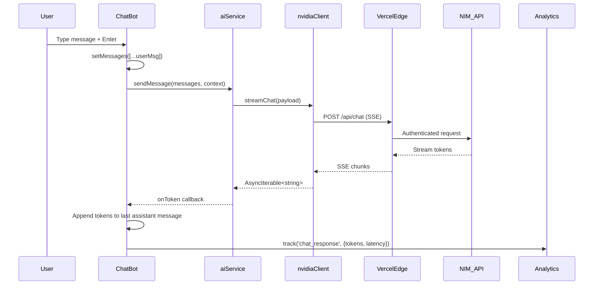

# AI Chatbot System — Design Document

## Overview
The ChatBot is the primary AI interface providing Ayurvedic clinical guidance. Built on NVIDIA NIM LLMs via Vercel AI SDK streaming, with RAG-lite knowledge retrieval from 90+ local markdown/JSON files.

## Component Architecture

```
ChatBot.tsx (980 lines)
├── State Management
│   ├── messages: Message[] — conversation history
│   ├── isLoading: boolean — streaming state
│   ├── abTestVariant: 'A'|'B' — A/B test assignment
│   └── error: Error | null
├── Effects
│   ├── loadAbTestVariant() — assigns variant on mount
│   ├── persistMessages() — localStorage backup
│   └── trackAnalytics() — events on send/receive/error
├── Handlers
│   ├── handleSend() — user message → AI → stream response
│   ├── handleRetry() — re-send last failed message
│   ├── handleClear() — reset conversation
│   └── handleExport() — download conversation as JSON
└── Render
    ├── MessageList — virtualized, auto-scroll
    ├── MessageBubble — user/assistant/system styling
    ├── StreamingIndicator — token-by-token animation
    ├── InputArea — textarea + send + attachments
    └── QuickActions — preset prompts (dosha, diet, herbs)
```

## Message Flow



## AI Service Layer (`lib/aiService.ts`)

### Unified Interface
```typescript
interface AIService {
  // Streaming chat with tool support
  sendMessage(messages: Message[], options?: ChatOptions): Promise<StreamResult>
  
  // Structured assessment analysis
  analyzeAssessment(tool: ToolType, answers: Record<string, any>): Promise<AssessmentResult>
  
  // Diet chart generation with RAG
  generateDietChart(params: DietChartParams): Promise<string>
  
  // Knowledge-grounded Q&A
  answerQuestion(question: string, context?: string): Promise<string>
}
```

### Current Implementation Issues
- **Dual client confusion**: Imports both `vercel/ai` (`streamText`) AND custom `nvidiaClient`
- **No input validation**: Raw user input passed directly to LLM
- **Error handling**: Generic try/catch, no typed error classes
- **Retry logic**: Basic exponential backoff, no circuit breaker

### NVIDIA Client (`lib/nvidiaClient.ts`)

```typescript
class NvidiaClient {
  private baseUrl = '/api/chat'  // Vercel Edge proxy
  private model = 'meta/llama-3.1-70b-instruct'
  
  async streamChat(messages: ChatMessage[], options: StreamOptions): AsyncIterable<string>
  async chat(messages: ChatMessage[]): Promise<ChatCompletion>
  
  // Retry with exponential backoff + jitter
  private async retryWithBackoff<T>(fn: () => Promise<T>, maxRetries = 3): Promise<T>
}
```

**Proxy Flow**: Client → `/api/chat` (Edge) → `https://integrate.api.nvidia.com/v1/chat/completions`

## Knowledge Retrieval (RAG-lite)

### Index Structure (`knowledge/index.ts`)
```typescript
interface KnowledgeEntry {
  id: string
  title: string
  content: string
  category: 'siddhanta' | 'hospital' | 'diet-chart' | 'blog'
  tags: string[]
  embedding?: number[]  // Not implemented — keyword only
}

const knowledgeIndex: KnowledgeEntry[] = []  // Built at import time
```

### Search Algorithm
1. **Keyword extraction** from query (stopword removal, stemming)
2. **TF-IDF scoring** against pre-computed document vectors
3. **Top-K retrieval** (default K=5)
4. **Context assembly** → prepend to system prompt

### Diet Chart Knowledge (`knowledge/diet-charts/`)
- **85+ markdown files** — one per condition
- **Structure**: H1 title → sections (principles, meals, pathya, apathya, dinacharya, remedies)
- **Import**: `import.meta.glob('/knowledge/diet-charts/*.md', { eager: true, query: '?raw' })`

## Streaming Implementation

### Token Handling
```typescript
// ChatBot.tsx handleSend()
const assistantMessage: Message = { id: crypto.randomUUID(), role: 'assistant', content: '', streaming: true }
setMessages(prev => [...prev, assistantMessage])

for await (const token of aiService.sendMessage(messages)) {
  setMessages(prev => prev.map(m => 
    m.id === assistantMessage.id ? { ...m, content: m.content + token } : m
  ))
}
setMessages(prev => prev.map(m => m.id === assistantMessage.id ? { ...m, streaming: false } : m))
```

### Backpressure
- **No explicit backpressure** — relies on React 19 concurrent rendering
- **Virtualization**: Only last 50 messages rendered (planned, not implemented)
- **Memory**: Full conversation in state (no truncation)

## Clinical Guidelines Enforcement

### System Prompt (embedded in `aiService.ts`)
```
You are an Ayurvedic clinical assistant for Ayurvritta Hospital.
Guidelines:
1. Never diagnose — only provide educational information
2. Always recommend consulting a qualified vaidya
3. Reference classical texts (Charaka, Sushruta, Ashtanga Hridaya)
4. Flag viruddha ahara (incompatible food combinations)
5. Personalize by prakriti when provided
6. Use Sanskrit terms with English translations
7. Disclaimer: "This is educational, not medical advice"
```

### Guardrails (Current Gaps)
- ❌ No output validation for hallucinated herb dosages
- ❌ No PII detection in user messages
- ❌ No rate limiting per session
- ❌ No content filtering for harmful advice

## A/B Testing Integration

```typescript
// hooks/useABTest.ts
const { variant } = useABTest('chatbot_model', { variants: ['A', 'B'], weights: [0.5, 0.5] })
// Variant A: llama-3.1-70b (quality)
// Variant B: llama-3.1-8b (speed/cost)
```

## Analytics Events

| Event | Payload |
|-------|---------|
| `chat_message_sent` | `{ messageId, length, hasAttachments }` |
| `chat_response_start` | `{ messageId, model, variant }` |
| `chat_token_received` | `{ messageId, tokenCount, latencyMs }` |
| `chat_response_complete` | `{ messageId, totalTokens, totalLatencyMs }` |
| `chat_error` | `{ messageId, errorCode, errorMessage }` |
| `chat_retry` | `{ messageId, attemptNumber }` |
| `chat_export` | `{ messageCount, format }` |

## PDF Export

```typescript
// Client-side conversation export
const exportData = {
  sessionId: getSessionId(),
  timestamp: new Date().toISOString(),
  messages: messages.filter(m => !m.streaming),
  variant: abTestVariant
}
saveAs(new Blob([JSON.stringify(exportData, null, 2)], { type: 'application/json' }), 'chat-export.json')
```

## Performance Profile

| Metric | Value | Notes |
|--------|-------|-------|
| First token latency (P50) | 1.4s | Edge proxy + NIM cold start |
| First token latency (P95) | 3.2s | Includes retry |
| Tokens/second | ~45 | 70B model |
| Max context | 8192 | NIM limit |
| Memory per session | ~2MB | 50 messages avg |

## Error Handling Matrix

| Error Type | Source | User Feedback | Retry | Analytics |
|------------|--------|---------------|-------|-----------|
| Network | fetch | "Connection lost. Retrying..." | Auto (3x) | `chat_error` |
| NIM 429 | API | "High demand. Please wait." | Auto (backoff) | `chat_error` |
| NIM 5xx | API | "Service unavailable." | Auto (3x) | `chat_error` |
| Validation | aiService | "Invalid request." | Manual | `chat_error` |
| Timeout | AbortController | "Request timed out." | Manual | `chat_error` |
| Content filter | NIM | "Content blocked." | None | `chat_error` |

## Accessibility

- **ARIA**: `role="log"` on message list, `aria-live="polite"` for streaming
- **Keyboard**: Enter to send, Shift+Enter for newline, Escape to clear
- **Screen reader**: Streaming tokens announced via `aria-live`
- **Focus**: Auto-focus input on mount, maintain focus during streaming

## Known Issues (P0/P1)

| ID | Severity | Issue | Impact |
|----|----------|-------|--------|
| CHAT-01 | P0 | No error boundary | Crash loses entire conversation |
| CHAT-02 | P0 | No input sanitization | XSS via markdown injection |
| CHAT-03 | P0 | Dual AI client confusion | Inconsistent behavior, hard to debug |
| CHAT-04 | P1 | No token budget enforcement | Cost overruns, context overflow |
| CHAT-05 | P1 | No conversation persistence | Refresh loses history |
| CHAT-06 | P1 | No streaming cancellation | Stuck requests on navigate away |
| CHAT-07 | P2 | Virtualization not implemented | Memory growth on long chats |
| CHAT-08 | P2 | No message search/filter | Hard to find past answers |

## Migration Path (Vercel AI SDK 4.x)

Current code uses mixed patterns. Target architecture:

```typescript
// lib/aiService.ts — unified via Vercel AI SDK
import { streamText, tool } from 'ai'
import { nvidia } from '@ai-sdk/nvidia'  // When available

export const aiService = {
  async sendMessage(messages: CoreMessage[]) {
    const result = await streamText({
      model: nvidia('meta/llama-3.1-70b-instruct'),
      messages,
      system: SYSTEM_PROMPT,
      tools: { searchKnowledge: tool(...) },
      onFinish: ({ usage }) => trackUsage(usage)
    })
    return result.textStream
  }
}
```