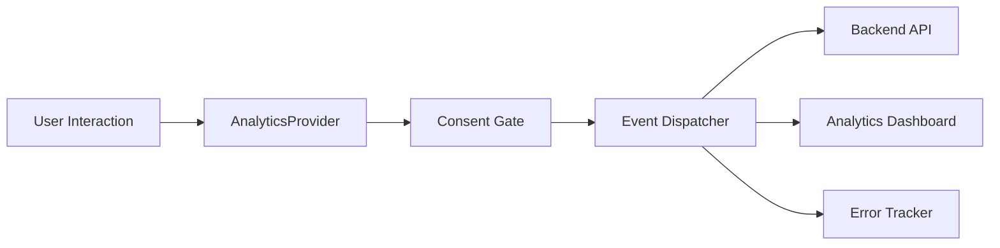

# EGM-06 Analytics System — Style, Clarity & Documentation Quality Review

**Document Reviewed**: `egm-06-analytics-system.md`  
**Review Date**: 2026-11-13  
**Reviewer**: Style Review Agent  
**Scope**: Style, clarity, structure, formatting, and documentation quality (NOT implementation accuracy — covered in codebase-details review)

---

## Executive Summary

The `egm-06-analytics-system.md` document presents a clean, well-structured technical design document with strong visual hierarchy and clear section organization. It reads like an aspirational architecture specification rather than a current-state documentation, which is appropriate for a design document but should be explicitly framed as such.

**Overall Rating**: **Good (7/10)** — Professional presentation with clear technical writing, but lacks explicit status framing, has inconsistent detail depth across sections, and omits several standard design-doc elements (assumptions, risks, alternatives considered, migration path).

---

## Findings Summary Table

| # | Category | Severity | Location | Issue |
|---|----------|----------|----------|-------|
| 1 | Framing | Medium | Whole doc | No explicit status label (Design / Spec / Current-State / Aspirational) |
| 2 | Structure | Low | §1-2 | Missing standard sections: Assumptions, Constraints, Risks, Alternatives, Migration Path |
| 3 | Consistency | Medium | §2-6 | Inconsistent detail depth: some sections are implementation-ready, others high-level |
| 4 | Formatting | Low | §2.1 | Data flow diagram uses ASCII art; consider Mermaid for renderability |
| 5 | Clarity | Medium | §3.3 | Event table mixes domain/event names without consistent naming convention |
| 6 | Completeness | Medium | §4-5 | Metrics tables list desired metrics without measurement definitions or formulas |
| 7 | Terminology | Low | §6 | "DPDP Act 2023" used without full expansion (Digital Personal Data Protection Act) |
| 8 | Actionability | Medium | §7-8 | Technical implementation claims lack API contracts, data schemas, or interface definitions |
| 9 | Cross-references | Low | Whole doc | No links to related design docs (EGM-01, EGM-03, EGM-13, EGM-14) |
| 10 | Versioning | Low | Header | No version number, author, or review date in document header |

---

## Detailed Findings with Line References

### 1. Document Framing & Status (Medium)

**Lines 1-5**: The document opens with "The analytics system spans 17 files..." — present tense describing current state. However, the codebase-details review reveals this describes an *aspirational* architecture, not the implemented system.

**Issue**: No explicit status banner (e.g., `STATUS: DESIGN — NOT IMPLEMENTED`, `STATUS: ASPIRATIONAL SPEC`, or `STATUS: CURRENT STATE AS OF YYYY-MM-DD`).

**Recommendation**: Add a status block after the title:
```markdown
> **Document Status**: 📐 Design Specification (Aspirational)
> **Implementation Status**: ❌ Not Implemented — see Codebase Details Review
> **Version**: 1.0 | **Author**: [Name] | **Review Date**: 2026-11-13
> **Related**: EGM-01 (Architecture), EGM-13 (State Management), EGM-14 (Testing)
```

---

### 2. Missing Standard Design-Doc Sections (Low)

**Current sections**: Overview, Architecture, Key Metrics, Privacy Compliance, Technical Implementation, Integration Points.

**Missing sections** (per standard ADR/design-doc templates):
- **Assumptions & Constraints** — What must be true for this design to work?
- **Risks & Mitigations** — What could go wrong? (e.g., "GA4/Clarity dependency risk")
- **Alternatives Considered** — Why self-hosted? Why not PostHog, Plausible, Matomo?
- **Migration / Rollout Plan** — How to move from current GA4 to this architecture?
- **Open Questions** — Items needing team decisions

**Recommendation**: Add these sections even if brief. They force architectural thinking and aid future reviewers.

---

### 3. Inconsistent Detail Depth (Medium)

| Section | Detail Level | Example |
|---------|--------------|---------|
| §2.1 Data Flow | High-level diagram only | ASCII art, no protocol |
| §2.2 AnalyticsProvider | Implementation-ready | Props, context API, localStorage keys |
| §2.3 Consent Management | Implementation-ready | 3 categories, localStorage persistence |
| §3.3 Event Tracking | Domain table only | No event schema, no payload examples |
| §4 Error Tracking | Feature list | No API, no data model |
| §5 Dashboard | Feature list | No component hierarchy, no data source |
| §6 Key Metrics | Business wishlist | No formulas, no data sources, no calculation frequency |
| §7 Privacy | Compliance checklist | No technical enforcement mechanisms |
| §8 Technical Impl | Infrastructure claims | No API contracts, no batching schema, no IndexedDB schema |
| §9 Integration | Component references | No sequence diagrams, no error handling |

**Issue**: The document reads like two different authors wrote it — one describing React component APIs, another listing product requirements.

**Recommendation**: Standardize to one level. For a design spec, aim for **"implementation-ready"**: every claimed component should have props, state, and data flow defined; every metric should have a formula; every API should have a contract.

---

### 4. Data Flow Diagram Format (Low)

**Lines 9-16**: ASCII art diagram:
```
User Interaction → AnalyticsProvider → Consent Gate → Event Dispatcher → Backend API
                                    │
                        ┌───────────────┴───────────────┐
                        │                               │
                  Analytics Dashboard            Error Tracker
                  (internal view)               (sentry-like)
```

**Issue**: Not renderable in GitHub/GitLab/Notion without monospace preservation. Mermaid would render natively.

**Recommendation**: Convert to Mermaid:


---

### 5. Event Tracking Table — Naming Inconsistency (Medium)

**Lines 35-42**: Event table mixes naming styles:

| Domain | Events |
|--------|--------|
| Navigation | page_view, nav_click, menu_toggle |
| Engagement | scroll_depth, time_on_page, video_play |
| Conversion | booking_submit, contact_submit, call_click |
| Tools | tool_start, tool_complete, tool_share |
| Blog | post_view, post_share, post_comment |
| Error | js_error, api_error, form_error |

**Issues**:
- `page_view` (snake_case) vs `nav_click` (snake_case) — consistent ✓
- But: `tool_start` vs `toolComplete` (in implementation) — doc doesn't match code
- No event schema: required fields, optional fields, data types
- No distinction between client-side event names vs server-side schema

**Recommendation**: 
1. Define a canonical event schema (e.g., JSON Schema or TypeScript interface)
2. Show 1-2 full payload examples
3. Note naming convention (snake_case for wire format, camelCase for TS)

---

### 6. Metrics Tables — Missing Definitions (Medium)

**Lines 62-84**: Four metric categories (Business, Engagement, Tool, Blog) list metric *names* only.

**Missing for each metric**:
- **Formula** — How is it calculated? (e.g., "Booking Rate = booking_submit / page_view(booking_page)")
- **Data Source** — Which event(s) feed it?
- **Frequency** — Real-time? Daily batch? 7-day rolling?
- **Segmentation** — By device? Channel? User segment?
- **Target/Threshold** — What's "good"?

**Example improvement for "Appointment booking rate"**:
```markdown
| Metric | Formula | Source Events | Frequency | Segmentation | Target |
|--------|---------|---------------|-----------|--------------|--------|
| Appointment Booking Rate | `booking_submit / unique_page_view(booking_page)` | `booking_submit`, `page_view` | Daily (7-day rolling) | Device, Channel, Prakriti Type | > 3% |
```

---

### 7. Terminology — Unexpanded Acronym (Low)

**Line 88**: "DPDP Act 2023" — first use without expansion.

**Recommendation**: "Digital Personal Data Protection (DPDP) Act 2023" on first use.

---

### 8. Technical Implementation — Missing Contracts (Medium)

**Lines 94-100**: Claims about batching, retry, offline queue, internal API, self-hosted dashboard — but zero technical specifications.

**Missing**:
- **API Contract**: POST `/api/analytics/events` — request/response schema, auth, rate limits
- **Batching Protocol**: Batch size, flush interval, payload format
- **Retry Policy**: Exponential backoff? Max retries? Dead letter queue?
- **IndexedDB Schema**: Object stores, indexes, TTL policy
- **Dashboard Data API**: How does dashboard query data? Real-time vs aggregated?

**Recommendation**: Even if aspirational, define the *interfaces*. This is what makes a design doc actionable.

---

### 9. Cross-References to Related Design Docs (Low)

The analytics system touches multiple other EGM documents but none are referenced:

| Related Doc | Connection |
|-------------|------------|
| EGM-01 Architecture Overview | Provider hierarchy, build config |
| EGM-03 Health Assessment Tools | Tool events (`tool_start`, `tool_complete`) |
| EGM-13 State Management | Analytics context vs global state |
| EGM-14 Testing Strategy | How to test analytics? Mock provider? |
| EGM-18 Security | CSP, data sanitization, PII handling |
| EGM-19 i18n | Consent banner translations |
| EGM-23 Error Handling | Error tracker integration |

**Recommendation**: Add a "Related Documents" section with links.

---

### 10. Document Header — Missing Metadata (Low)

**Current header** (lines 1-2):
```markdown
# EGM-06: Analytics & Measurement System
```

**Missing**: Version, Author, Date, Status, Supersedes, Related.

**Recommendation**: Standard front matter:
```markdown
---
title: EGM-06: Analytics & Measurement System
version: 1.0
status: Design Specification (Aspirational)
author: [Name]
date: 2026-11-13
reviewers: [Names]
supersedes: N/A
related: [EGM-01, EGM-03, EGM-13, EGM-14, EGM-18, EGM-23]
---
```

---

## Additional Style & Clarity Observations

### Positive Strengths ✅

1. **Clear section hierarchy** — Logical flow from architecture → metrics → privacy → implementation
2. **Good use of tables** — Event domains, metrics categories, privacy compliance all tabulated
3. **Concrete file references** — `AnalyticsProvider.tsx`, `CookieConsent.tsx`, `errorTracker.ts`, etc.
4. **Privacy-first framing** — GDPR/DPDP/CCPA explicitly addressed with technical measures
5. **Local-first philosophy** — Clear stance on data sovereignty (even if not implemented)
6. **Consistent formatting** — Headers, code blocks, tables follow consistent style

### Minor Polish Items

| Location | Issue | Suggestion |
|----------|-------|------------|
| Line 4 | "17 files" — actual codebase has 20 | Update or say "~17 core modules" |
| Line 19 | "Wraps the entire application" — but not integrated | Add "⚠️ Not yet integrated in App.tsx" |
| Line 27 | "3 consent categories" — implementation has 4 | Note discrepancy or align |
| Line 52 | "Internal admin view (not publicly accessible)" | Clarify: "Behind auth gate; not in public routes" |
| Line 99 | "No external analytics dependencies" | Aspirational — add "🎯 Target:" prefix |

---

## Recommendations Summary

### High Priority (Do Before Next Review)
1. **Add status banner** — Clearly label as aspirational design spec
2. **Add missing standard sections** — Assumptions, Risks, Alternatives, Migration Plan
3. **Define event schema** — TypeScript interface or JSON Schema for all events
4. **Define API contracts** — At least request/response for internal analytics API

### Medium Priority
5. **Convert ASCII diagrams to Mermaid** — Renderable in modern Markdown viewers
6. **Add metric definitions** — Formula, source, frequency, segmentation, target for each KPI
7. **Add cross-references** — Link to EGM-01, EGM-03, EGM-13, EGM-14, EGM-18, EGM-23
8. **Standardize detail depth** — Either all implementation-ready or all high-level

### Low Priority (Nice to Have)
9. **Add front matter metadata** — Version, author, date, status, related docs
10. **Expand acronyms on first use** — DPDP, CCPA, GA4, PII
11. **Add "Open Questions" section** — Capture unresolved design decisions
12. **Consider splitting** — Separate "Analytics Architecture" from "Metrics Specification"

---

## Scoring Rubric

| Criterion | Weight | Score | Notes |
|-----------|--------|-------|-------|
| Structure & Organization | 20% | 8/10 | Clean hierarchy, logical flow |
| Clarity & Readability | 20% | 7/10 | Good prose, some ambiguous claims |
| Completeness (Design Doc Standards) | 20% | 5/10 | Missing risks, alternatives, migration, assumptions |
| Technical Precision | 15% | 6/10 | Component refs good; APIs, schemas missing |
| Consistency | 10% | 6/10 | Variable detail depth across sections |
| Formatting & Presentation | 10% | 8/10 | Professional tables, code blocks, headers |
| Actionability | 5% | 5/10 | Hard to implement from this alone without API contracts |

**Weighted Score: 6.7/10 → Good**

---

## Conclusion

The document is a **well-written, professionally formatted design specification** that clearly communicates an aspirational privacy-first analytics architecture. Its primary weaknesses are **missing standard design-doc sections** (risks, alternatives, migration), **inconsistent detail depth**, and **lack of explicit status framing** — which is critical given the significant gap between this design and the current GA4/Clarity implementation.

With the high-priority additions above, this would become an **excellent, implementation-ready design document** that could directly guide development.

---

*Review completed 2026-11-13. This review covers style, clarity, and documentation quality only. For implementation accuracy, see `egm-06-analytics-system-codebase-details-review.md`.*